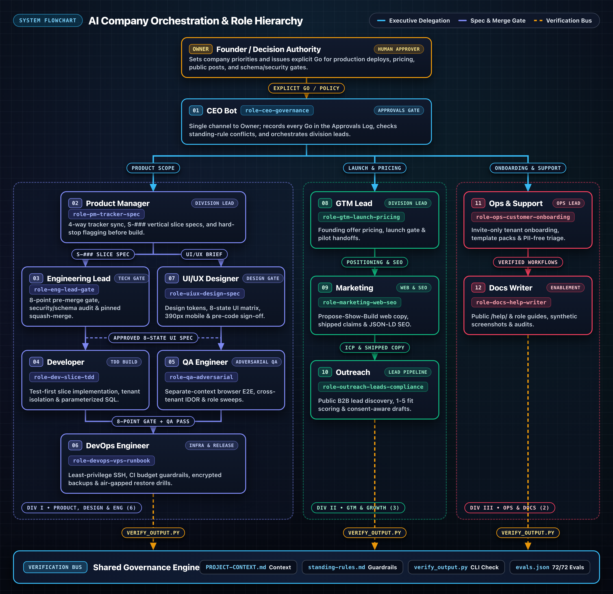
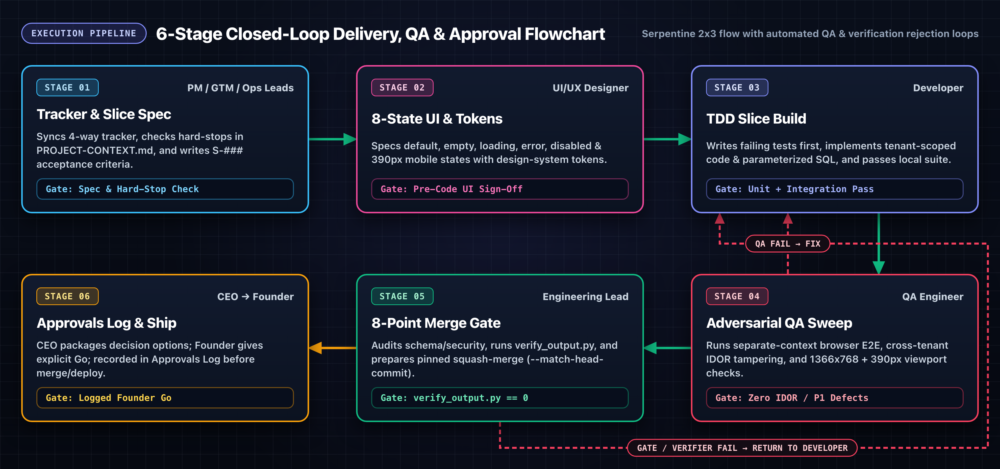

<p align="center">
    
    
    
    
</p>

<h1 align="center">AI Company Orchestration Skills - Full-Company Agent Skills for AI Teams</h1>

A complete 12-role agent skill suite that orchestrates AI coding and operations assistants into a disciplined, full-company SaaS organization: spanning Executive Governance (CEO), Product Management, UI/UX Design, Engineering Leadership, TDD Development, Adversarial QA, DevOps, GTM, Marketing SEO, Outreach, Customer Onboarding, and Documentation.

AI assistants are great at generating isolated code or copy fast, but when running an end-to-end product they consistently skip organizational and production fundamentals: merging unverified PRs, leaking cross-tenant data (IDOR), burning CI budgets, claiming unshipped features on marketing pages, or modifying production servers without rollback plans. This skill suite enforces real company hierarchy, approval gates, and verification checks before work ships.

## Background

This skill suite was built to solve the chaos of multi-agent software teams. When multiple AI agents collaborate on a product without strict role boundaries, handoff protocols, and an executive approvals gate, they overwrite each other's work or bypass critical security checks. Each skill in this repository gives its assigned agent a clear standing remit, mandatory pre-flight checks, and a deterministic Python verifier (`scripts/verify_output.py`).

It uses the [Agent Skills](https://agentskills.io/home) format, so it works with Claude Code, OpenAI Codex, OpenBot, and other compatible agent platforms.

All 12 skills are **100% project-agnostic**. Each skill loads its rules from modular reference files (`references/standing-rules.md`) and your workspace's `PROJECT-CONTEXT.md` (template included in [`templates/PROJECT-CONTEXT.template.md`](templates/PROJECT-CONTEXT.template.md)). No wasted context on irrelevant checks, and zero hardcoded project data.

---

## Team Hierarchy & Role Matrix

<p align="center">
  
</p>

### End-to-End Execution & Governance Pipeline

<p align="center">
  
</p>

### Role Matrix (12 Full-Company Skills)

| Division | Agent Role | Skill & Command | Key Gateways & Automated Checks |
| :--- | :--- | :--- | :--- |
|  | **01. CEO** | [**`role-ceo-governance`**](skills/role-ceo-governance/SKILL.md) | Single voice to Owner, Approvals log gatekeeping, 5-part evening summary, standing-rule conflict checks, manager handoffs |
|  | **02. Product Manager** | [**`role-pm-tracker-spec`**](skills/role-pm-tracker-spec/SKILL.md) | 4-way tracker sync (`REQUIREMENTS.md`, board, issues, docs), `S-###` slice specs, hard-stop flagging, module sequencing |
|  | **03. Engineering Lead** | [**`role-eng-lead-gate`**](skills/role-eng-lead-gate/SKILL.md) | 8-point pre-merge gate, schema/security audit sign-off, pinned squash-merge (`--match-head-commit`), CI budget guard |
|  | **04. Developer** | [**`role-dev-slice-tdd`**](skills/role-dev-slice-tdd/SKILL.md) | Test-first (TDD) slice workflow, cross-tenant & role-isolation tests, parameterized raw SQL (`$queryRaw`), pre-push checks |
|  | **05. QA Engineer** | [**`role-qa-adversarial`**](skills/role-qa-adversarial/SKILL.md) | Separate-context adversarial testing, cross-tenant IDOR route sweeps, role-boundary probes, `1366x768` & `390px` viewports |
|  | **06. DevOps** | [**`role-devops-vps-runbook`**](skills/role-devops-vps-runbook/SKILL.md) | Least-privilege SSH (`visudo -cf`, `--no-pager`), streaming `age` DB backups, `--network none` container restore tests |
|  | **07. UI/UX Designer** | [**`role-uiux-design-spec`**](skills/role-uiux-design-spec/SKILL.md) | Design-system token compliance, 8-state UI matrix (`default`, `empty`, `loading`, `error`, `disabled`, `390px`), pre-code sign-off |
|  | **08. GTM Lead** | [**`role-gtm-launch-pricing`**](skills/role-gtm-launch-pricing/SKILL.md) | Founding offer pricing analysis, launch readiness gate checklist, outreach/marketing review, pilot customer handoffs |
|  | **09. Marketing** | [**`role-marketing-web-seo`**](skills/role-marketing-web-seo/SKILL.md) | Propose-Show-Build web workflow, shipped-only feature claims (`Done` in tracker), technical SEO / JSON-LD, `390px` PR proof |
|  | **10. Outreach Researcher** | [**`role-outreach-leads-compliance`**](skills/role-outreach-leads-compliance/SKILL.md) | Public-source B2B lead discovery, 1-5 fit scoring, opt-out registry checks, consent-aware multi-language drafts |
|  | **11. Ops & Support Lead** | [**`role-ops-customer-onboarding`**](skills/role-ops-customer-onboarding/SKILL.md) | Invite-only tenant onboarding, starter template pack sign-off, add-on rollout checklists, PII-free support triage |
|  | **12. Docs Writer** | [**`role-docs-help-writer`**](skills/role-docs-help-writer/SKILL.md) | Public `/help/` and role-based `docs/user-guide/` authoring, synthetic-only screenshot standards, privacy placeholder audits |

---

## Installing AI Company Orchestration Skills

### Claude Code

```bash
# Install an individual role skill
npx skills add https://github.com/khadervali/ai-company-orchestration-skills --skill role-ceo-governance

# Or install engineering & QA gates
npx skills add https://github.com/khadervali/ai-company-orchestration-skills --skill role-eng-lead-gate
npx skills add https://github.com/khadervali/ai-company-orchestration-skills --skill role-qa-adversarial
```

If `npx` isn't available, install Node.js first: `brew install node` (macOS) or download from [nodejs.org](https://nodejs.org).

### OpenAI Codex

```bash
npx skills add https://github.com/khadervali/ai-company-orchestration-skills --skill role-dev-slice-tdd
```

Select "Codex" when prompted for the agent platform.

### Manual Installation (Claude Code & OpenBot)

Clone this repo and copy the `skills/role-*/` folders to your project or global skills directory, and copy [`templates/PROJECT-CONTEXT.template.md`](templates/PROJECT-CONTEXT.template.md) to your project root as `PROJECT-CONTEXT.md`:

```bash
# Project-level (applies to one project)
mkdir -p .claude/skills
cp -r skills/role-* .claude/skills/
cp templates/PROJECT-CONTEXT.template.md ./PROJECT-CONTEXT.md

# Global (applies to all projects)
mkdir -p ~/.claude/skills
cp -r skills/role-* ~/.claude/skills/
```

## Using AI Company Orchestration Skills

**Claude Code:** Use `/role-ceo-governance`, `/role-eng-lead-gate`, `/role-qa-adversarial`, `/role-dev-slice-tdd` (or any of the 12 role commands) to trigger that role's workflow directly, or ask naturally: "package today's approval requests", "review this PR against the 8-point merge gate", "run an adversarial IDOR sweep".

**Codex:** Use `$role-eng-lead-gate` or describe the role task you need: "check this slice against our merge gate", "audit this backup script".

**OpenBot:** Assign each `role-*` skill to its corresponding agent in your OpenBot server (`CEO`, `Product Manager`, `Engineering Lead`, `Developer`, `QA Engineer`, `DevOps`, `UI/UX Designer`, `GTM Lead`, `Marketing`, `Outreach Researcher`, `Ops and Support Lead`, `Docs Writer`). Each skill activates automatically when that agent executes its daily workflow.

## What It Checks

| Category | What It Catches & Prevents |
|----------|----------------------------|
| **Executive Approvals Gate** | Unapproved merges or deploys, inferred "silent" approvals, missing Approvals log rows, standing-rule conflicts |
| **Multi-Tenant Isolation (IDOR)** | Missing `tenant_id` scoping on queries, cross-tenant ID tampering across GET/POST/PATCH/DELETE routes, role escalation |
| **Database & Raw SQL Safety** | Unparameterized raw SQL (`$queryRawUnsafe`), unreviewed schema migrations, untested backup restores, plaintext DB dumps |
| **Pre-Merge & CI Governance** | Unpinned squash-merges (missing `--match-head-commit`), high/critical `pnpm audit` advisories, blind CI reruns, missing PR Evidence |
| **UI/UX & Brand Fidelity** | Missing empty/loading/error/disabled states, broken `390px` mobile layouts, unapproved designs merged before owner sign-off |
| **GTM, SEO & Outreach Integrity** | Marketing pages claiming unshipped features, missing JSON-LD / OpenGraph tags, outreach sent without opt-out checks or human go |
| **Customer Onboarding & Docs** | Public self-signup leaks on invite-only apps, unverified starter templates, real customer PII in screenshots or support tickets |

## Contributing

Contributions, corrections, and improvements are welcome! If you've found a coordination or production anti-pattern that AI agents keep introducing, please add it.

See [CONTRIBUTING.md](CONTRIBUTING.md) for guidelines.

## License

AI Company Orchestration Skills is available under the MIT License. See [LICENSE](LICENSE) for details.
